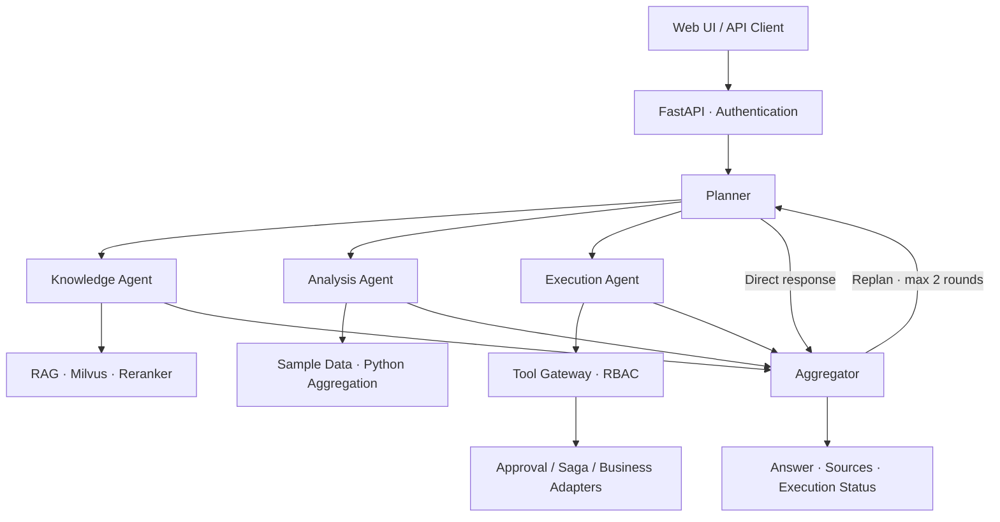

# BusinessAgent · Zhiduoxing

A multi-agent platform for enterprise knowledge and business workflows, bringing retrieval, data analysis, and business operations into a shared natural-language workflow.

[简体中文](README.md) | **English**

[Quick start](#quick-start) · [Architecture](#architecture) · [Documentation](#documentation)

[](https://github.com/zhenkun26/BusinessAgent/actions/workflows/ci.yml)
[](enterprise-agent/pyproject.toml)
[](LICENSE)

## Overview

A business request can involve checking a policy, retrieving data, and performing an operation.
BusinessAgent uses a Planner to break requests into subtasks, delegates them to specialized agents, and combines their results.

The project covers the path from a natural-language request to business execution:

- For questions, retrieve knowledge accessible to the user and provide source information.
- For analysis, calculate statistics in Python and use a model to explain the results.
- For business operations, check tool permissions and apply human approval where required.
- When a multistep operation fails, run Saga compensation for supported steps and record the outcome.

The repository includes a backend service, Web interface, evaluation scripts, and deployment configuration.
It is intended for exploring multi-agent orchestration, enterprise RAG, and controlled tool execution.

## Use cases

These examples require the relevant knowledge documents, user roles, and model configuration.
The shipped sample documents and interface are primarily in Chinese; the requests below describe the same scenarios in English.

| Scenario | Example request | Workflow |
| --- | --- | --- |
| Enterprise knowledge Q&A | “What are the company's travel reimbursement rules?” | Retrieve knowledge, compose an answer, and return sources |
| Business data analysis | “Rank customers by their total order value.” | Parse an analysis plan, aggregate data in Python, and generate a report |
| Business record lookup | “Look up customer C001.” | Check role permissions before calling a business tool |
| Business operations | “Create a support ticket for customer C001.” | Extract parameters, check permissions, and call the ticket tool |
| Approval collaboration | “Send a follow-up email to an external customer.” | Create an approval request according to operation rules for an authorized reviewer |
| Combined requests | “Look up the customer and explain the company's after-sales policy.” | Dispatch subtasks to different agents and aggregate the results |

> Business tools use the Mock provider by default, and analysis currently reads built-in sample data.
> These examples demonstrate workflows. Connecting real business systems requires adapter configuration and integration testing.

## Core capabilities

### Multi-agent orchestration

- A Planner → Agent Executor → Aggregator workflow built with LangGraph.
- Parallel subtask dispatch through the Send API.
- Knowledge, Analysis, and Execution agents with distinct responsibilities.
- Bounded replanning for results that require additional retrieval, with at most 2 extra rounds.

### Knowledge retrieval and answers

- Document loading for Markdown, PDF, DOCX, and TXT.
- Milvus vector retrieval followed by reranking.
- Local BGE-M3 embeddings and a BGE Reranker by default.
- Role and department namespace filtering in the retrieval path.
- Source information, confidence-based decisions, and fallback paths for retrieval failures.

### Controlled business execution

- Tools for customers, orders, CRM tasks, tickets, email, and approval queries.
- RBAC to restrict tool access by role.
- Human approval for operations that require review.
- Saga coordination for multistep execution and supported compensation scenarios.
- An external HTTP adapter layer with timeouts, retries, and audit records.

### State management and observability

- Checkpoints to save conversation state and support recovery.
- A Redis → PostgreSQL → memory checkpoint fallback chain.
- SSE events for execution progress and response text.
- Audit logs, token usage collection, Prometheus metrics, and OpenTelemetry tracing.
- APIs for prompt versioning, knowledge candidate review, and user administration.

## Architecture

The following diagram simplifies the main workflow:



| Layer | Main technologies |
| --- | --- |
| API and interaction | FastAPI, Web UI, SSE |
| Agent orchestration | LangGraph, LangChain |
| Model access | OpenAI-compatible API, Ollama |
| Retrieval and reranking | Milvus, BGE-M3, BGE Reranker |
| Business data and state | PostgreSQL, Redis Stack |
| Security and workflows | JWT, RBAC, human approval, Saga |
| Observability | OpenTelemetry, Prometheus, audit logs |
| Deployment and checks | Docker Compose, Kubernetes manifests, GitHub Actions |

## Quick start

These steps target local development on macOS / Linux.
Infrastructure runs through Docker Compose; the API and Worker run on the host.

### 1. Prerequisites

- Python 3.11+
- Git
- Docker and Docker Compose
- An available model service: a cloud API or Ollama with a model already installed
- Network access to download local embedding and reranking models, or existing model files

Local BGE models must be downloaded on first use. Startup time depends on the network and hardware.

### 2. Get the code and install dependencies

```bash
git clone https://github.com/zhenkun26/BusinessAgent.git
cd BusinessAgent/enterprise-agent

python3 -m venv .venv
source .venv/bin/activate

python -m pip install -r deploy/requirements-prod.txt

# Additional dependencies for local BGE models and document loading
python -m pip install \
  "langchain-community>=0.4" \
  "langchain-huggingface>=1.0" \
  "sentence-transformers>=3.0.0" \
  "torch>=2.2.0"
```

### 3. Configure environment variables

```bash
cp .env.example .env
```

Edit `.env` and review these settings:

| Setting | Purpose |
| --- | --- |
| `OPENAI_API_KEY`, `OPENAI_BASE_URL` | Access to the cloud model service |
| `PRIMARY_LLM_MODEL`, `LITE_LLM_MODEL` | Model names actually available from your provider |
| `LOCAL_LLM_BASE_URL`, `LOCAL_LLM_MODEL` | Configuration for Ollama, when used |
| `POSTGRES_*`, `REDIS_*`, `MILVUS_*` | Connection settings matching the running services |
| `JWT_SECRET_KEY` | Your own randomly generated secret |
| `HF_HOME` | A model cache directory writable by your local user |
| `TOOL_PROVIDER` | Keep `mock` for the initial walkthrough |

For a host-based setup, you can use:

```dotenv
HF_HOME=./.cache/huggingface
```

To use local language models, start Ollama separately and prepare the configured model.
The Compose command below starts only the database and retrieval dependencies.

Do not commit credentials from `.env`. The development Compose configuration is intended for local use.
See the deployment documentation for production configuration.

### 4. Start infrastructure

```bash
docker compose up -d etcd minio milvus-standalone postgres redis
docker compose ps
```

Wait for the services to become ready. PostgreSQL runs the initialization script when it first uses a new data volume.
For existing databases, refer to the operations guide for upgrades and migrations.

### 5. Import sample knowledge and start services

Import a sample policy document:

```bash
python -m app.rag.ingest \
  "eval/sample_docs/财务报销制度.md" \
  --type policy \
  --ns shared_company
```

Start the API:

```bash
python -m app.main
```

In another terminal, enter `enterprise-agent/`, activate the same virtual environment,
and start the background Worker:

```bash
python -m app.worker
```

The Worker handles background tasks, including document ingestion, approval timeouts, and compensation retries.

### 6. Open the application

| Entry point | URL |
| --- | --- |
| Web interface | http://localhost:8000/ui/ |
| API documentation | http://localhost:8000/docs |
| API liveness | http://localhost:8000/health |
| Dependency status | http://localhost:8000/ready |
| Prometheus metrics | http://localhost:8000/metrics |

The local development interface provides role-based demo entry points. Try this question against the Chinese sample policy:

> 公司的差旅报销有哪些规定？

This asks for the company's travel reimbursement rules.
Then use a role with order-query permission to try:

> 统计所有客户的订单总额。

This asks for total order value across customers.

`/health` checks whether the API is alive. Complete functionality also depends on databases,
retrieval services, models, and their configuration.

## Verification and tests

Run unit tests from `enterprise-agent/`:

```bash
python -m pip install pytest pytest-asyncio pytest-cov fakeredis
PYTHONPATH=. python -m pytest tests/
```

The repository also provides verification scripts for orchestration, state recovery,
tool execution, Milvus, and tracing:

```bash
python -m eval.run_w5_e2e
python -m eval.run_w6_checkpoint
python -m eval.run_w7_execution
python -m eval.run_w9_milvus
python -m eval.run_w9_tracing
```

Their prerequisites differ. Review each script and the relevant environment settings before running it.

CI includes Python 3.11 / 3.13 unit tests, secret scanning, dependency vulnerability scanning,
production image builds, and image scanning. See [GitHub Actions](https://github.com/zhenkun26/BusinessAgent/actions)
for the latest results.

## Current status and limitations

Core agent workflows, RAG, permission checks, approvals, compensation, and the Web interface are implemented.
The repository also contains automated tests, technical verification, and delivery records.

Current boundaries:

- Analysis uses built-in customer and order samples; a real analytics data source still needs integration.
- Business tools default to Mock mode. Adapter code alone does not establish acceptance against real systems.
- Real CRM, email, and SSO integration still requires interface contracts, test environments, and integration evidence.
- Formal UAT, security acceptance against real systems, staged rollout, and production approval remain incomplete.
- Subtask dependency scheduling, multitenancy, and long-term memory remain planned work.
- When checkpoints fall back to memory, state does not survive a process restart.

See the [ROADMAP](docs/40-process/ROADMAP.md) for detailed progress and outstanding work.

## Repository structure

```text
BusinessAgent/
├── README.md               # Chinese introduction and canonical navigation
├── README-en.md            # English translation
├── enterprise-agent/
│   ├── app/
│   │   ├── agents/          # Knowledge, Analysis, Execution
│   │   ├── graph/           # Planning, dispatch, aggregation, checkpoints
│   │   ├── rag/             # Ingestion, retrieval, reranking, fallback
│   │   ├── tools/           # Business tools, HTTP adapters, Saga
│   │   ├── api/             # Chat, authentication, approval, administration
│   │   ├── security/        # JWT and RBAC
│   │   ├── observability/   # Audit, tracing, metrics, token usage
│   │   └── static/          # Web interface
│   ├── tests/              # Automated tests
│   ├── eval/               # Evaluation scripts and sample documents
│   └── deploy/             # Deployment, database and monitoring configuration
├── docs/                   # Product, operations and engineering documentation
├── openspec/               # Specifications and change records
└── interview/              # Presentation and interview materials
```

## Documentation

The detailed project documentation below is primarily in Simplified Chinese.

| Topic | Entry point |
| --- | --- |
| Complete repository index | [contents](contents.md) |
| Product proposal | [Enterprise knowledge workflow Agent proposal](docs/10-product-plan/企业知识工作流Agent产品方案_v3_整合版.md) |
| Product features and design | [Product documentation](docs/20-product/产品文档.md) |
| Web interface usage | [User guide](docs/30-guides/产品使用手册-前端版.md) |
| Scenarios and examples | [Use case guide](docs/30-guides/使用案例手册.md) |
| Operations and troubleshooting | [Operations guide](docs/30-guides/运维维护手册.md) |
| Deployment configuration | [Deployment guide](enterprise-agent/deploy/DEPLOY.md) |
| Sample knowledge documents | [sample_docs](enterprise-agent/eval/sample_docs/) |
| Development progress | [ROADMAP](docs/40-process/ROADMAP.md) |
| Design decisions | [DECISIONS](docs/40-process/DECISIONS.md) |
| Known issues | [ISSUES](docs/40-process/ISSUES.md) |
| Version history | [CHANGELOG](CHANGELOG.md) |
| Presentation and interview materials | [Presentation page](interview/产品介绍网页/index.html) · [Interview notes](interview/Agent项目面试备稿.md) |

## Feedback and contributions

Use [GitHub Issues](https://github.com/zhenkun26/BusinessAgent/issues) to report problems or discuss improvements.
Include reproduction steps, expected behavior, actual behavior, and sanitized environment details.

Before contributing, read [AGENTS.md](AGENTS.md) and the
[project change workflow](openspec/specs/openspec-normalization/spec.md),
and run the checks relevant to your changes.

## License

[MIT](LICENSE)
