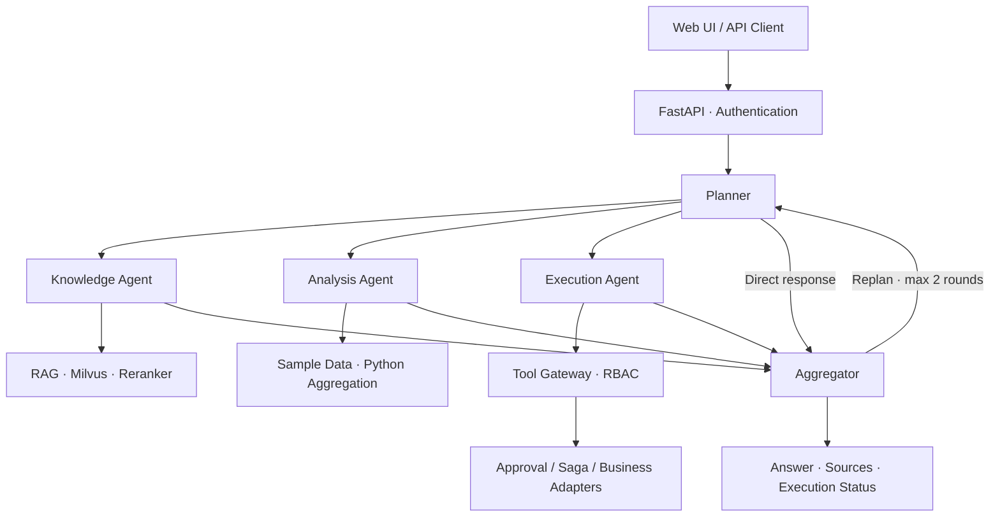

# BusinessAgent · 智多星

面向企业知识与业务流程的多智能体平台，将知识检索、数据分析和业务操作接入统一的自然语言工作流。

**简体中文** | [English](README-en.md)

[快速开始](#快速开始) · [系统架构](#系统架构) · [文档](#文档)

[](https://github.com/zhenkun26/BusinessAgent/actions/workflows/ci.yml)
[](enterprise-agent/pyproject.toml)
[](LICENSE)

## 项目介绍

企业中的一次业务请求，往往同时涉及查制度、取数据和执行操作。
BusinessAgent 通过 Planner 拆解请求，由不同 Agent 处理子任务，再汇总结果。

项目关注从自然语言请求到业务执行的完整过程：

- 回答问题时，检索用户有权访问的知识，并提供来源信息。
- 分析数据时，由 Python 完成统计计算，再由模型生成说明。
- 执行业务操作时，校验工具权限，并按操作规则进入人工审批。
- 多步骤操作失败时，对支持补偿的步骤执行 Saga 补偿并记录结果。

仓库包含后端服务、Web 交互界面、评测脚本和部署配置，适合研究多智能体编排、企业 RAG 与受控工具执行。

## 可以做什么

以下示例需要对应知识文档、用户角色及模型配置。

| 场景 | 示例请求 | 处理方式 |
| --- | --- | --- |
| 企业知识问答 | “公司的差旅报销有哪些规定？” | 检索知识库，组织回答并返回来源 |
| 业务数据分析 | “统计各客户的订单总额并进行排名。” | 解析分析计划，由 Python 聚合数据并生成报告 |
| 业务记录查询 | “查询客户 C001 的信息。” | 校验角色权限后调用业务工具 |
| 流程操作 | “为客户 C001 创建一个售后工单。” | 提取参数，执行权限检查并调用工单工具 |
| 审批协作 | “给外部客户发送一封跟进邮件。” | 根据操作规则创建审批请求，由有权限的人员处理 |
| 组合任务 | “查询客户信息，同时说明公司的售后政策。” | 将请求拆分为不同 Agent 的子任务并汇总结果 |

> 默认业务工具使用 Mock provider，数据分析当前使用内置样例数据。
> 示例用于体验工作流；连接真实业务系统需要配置适配器并完成联调。

## 核心能力

### 多智能体编排

- 使用 LangGraph 组织 Planner → Agent Executor → Aggregator 工作流。
- 通过 Send API 并行分发子任务。
- 由 Knowledge、Analysis、Execution 三类 Agent 承担不同职责。
- 对需要补充检索的结果进行有限重规划，最多追加 2 轮。

### 知识检索与回答

- 支持 Markdown、PDF、DOCX 和 TXT 文档加载。
- 使用 Milvus 向量召回与 Reranker 重排。
- 默认采用本地 BGE-M3 Embedding 和 BGE Reranker。
- 在检索路径中应用角色与部门命名空间过滤。
- 提供来源信息、置信度决策和检索异常降级路径。

### 受控业务执行

- 提供客户、订单、CRM 任务、工单、邮件与审批查询工具。
- 通过 RBAC 限定不同角色的工具访问权限。
- 对需要审批的操作接入人工审批流程。
- 使用 Saga 协调多步骤执行，并处理支持补偿的失败场景。
- 提供外部 HTTP 适配层，以及超时、重试和审计机制。

### 状态管理与可观测性

- 通过 Checkpointer 保存会话状态，支持状态恢复。
- 提供 Redis → PostgreSQL → 内存的 Checkpointer 降级链。
- 支持 SSE 输出执行进度与回答文本。
- 提供审计日志、Token 用量采集、Prometheus 指标和 OpenTelemetry 链路追踪。
- 提供 Prompt 版本管理、知识候选审核与用户管理接口。

## 系统架构

以下为主工作流的简化结构：



| 层次 | 主要技术 |
| --- | --- |
| API 与交互 | FastAPI、Web UI、SSE |
| Agent 编排 | LangGraph、LangChain |
| 模型接入 | OpenAI-compatible API、Ollama |
| 检索与重排 | Milvus、BGE-M3、BGE Reranker |
| 业务数据与状态 | PostgreSQL、Redis Stack |
| 安全与流程 | JWT、RBAC、人工审批、Saga |
| 可观测性 | OpenTelemetry、Prometheus、审计日志 |
| 部署与检查 | Docker Compose、Kubernetes 清单、GitHub Actions |

## 快速开始

以下以 macOS / Linux 的本地开发环境为例：
基础设施通过 Docker Compose 启动，API 与 Worker 在本机运行。

### 1. 准备环境

- Python 3.11+
- Git
- Docker 与 Docker Compose
- 可用的模型服务：云端 API，或已部署模型的 Ollama
- 本地 Embedding 与 Reranker 所需的模型下载网络或模型文件

首次使用本地 BGE 模型时需要下载模型，启动时间取决于网络与硬件。

### 2. 获取代码并安装依赖

```bash
git clone https://github.com/zhenkun26/BusinessAgent.git
cd BusinessAgent/enterprise-agent

python3 -m venv .venv
source .venv/bin/activate

python -m pip install -r deploy/requirements-prod.txt

# Additional dependencies for local BGE models and document loading
python -m pip install \
  "langchain-community>=0.4" \
  "langchain-huggingface>=1.0" \
  "sentence-transformers>=3.0.0" \
  "torch>=2.2.0"
```

### 3. 配置环境变量

```bash
cp .env.example .env
```

编辑 `.env`，重点检查以下配置：

| 配置项 | 用途 |
| --- | --- |
| `OPENAI_API_KEY`、`OPENAI_BASE_URL` | 云端模型访问配置 |
| `PRIMARY_LLM_MODEL`、`LITE_LLM_MODEL` | 按模型服务实际可用名称配置 |
| `LOCAL_LLM_BASE_URL`、`LOCAL_LLM_MODEL` | 使用 Ollama 时配置 |
| `POSTGRES_*`、`REDIS_*`、`MILVUS_*` | 与实际运行的依赖服务保持一致 |
| `JWT_SECRET_KEY` | 设置自己的随机密钥 |
| `HF_HOME` | 设置为本机可写的模型缓存目录 |
| `TOOL_PROVIDER` | 初次体验保持 `mock` |

本机运行时，可将模型缓存配置为：

```dotenv
HF_HOME=./.cache/huggingface
```

使用本地模型时，需另行启动 Ollama 并准备对应模型；
下面的 Compose 命令只启动数据库与检索依赖。

`.env` 中的凭据不应提交到仓库。开发 Compose 配置用于本地体验，
生产环境配置见部署文档。

### 4. 启动依赖服务

```bash
docker compose up -d etcd minio milvus-standalone postgres redis
docker compose ps
```

等待依赖服务就绪。C03 已取消 PostgreSQL 自动执行应用初始化 SQL；空库必须先显式迁移、检查版本并创建管理员，再启动应用。命令与凭证输入方式见[数据库初始化手册](enterprise-agent/deploy/DATABASE_BOOTSTRAP.md)。已有库只允许对获准的隔离副本显式接管，不直接修改当前库。

可先运行 `python -B -m app.core.db_bootstrap plan` 做离线预览；真实数据库、API 与 Linux 部署验收仍 BLOCKED。当前生产候选使用[外部模型 profile](enterprise-agent/deploy/MODEL_PROFILE.md)，下文涉及真实模型/入库的步骤需另行授权。

### 5. 导入示例知识并启动服务

先导入一份示例制度文档：

```bash
python -m app.rag.ingest \
  "eval/sample_docs/财务报销制度.md" \
  --type policy \
  --ns shared_company
```

启动 API：

```bash
python -m app.main
```

在另一个终端中，进入 `enterprise-agent/` 并激活同一虚拟环境，
启动后台 Worker：

```bash
python -m app.worker
```

Worker 负责后台任务，包括文档入库处理、审批超时与补偿重试。

### 6. 打开应用

| 入口 | 地址 |
| --- | --- |
| Web 界面 | http://localhost:8000/ui/ |
| API 文档 | http://localhost:8000/docs |
| 服务存活检查 | http://localhost:8000/health |
| 依赖状态 | http://localhost:8000/ready |
| Prometheus 指标 | http://localhost:8000/metrics |

本地开发界面提供角色体验入口。可以先尝试：

> 公司的差旅报销有哪些规定？

再使用具备订单查询权限的角色尝试：

> 统计所有客户的订单总额。

`/health` 用于检查 API 是否存活；
完整功能还依赖数据库、检索服务、模型及相应配置。

## 验证与测试

在 `enterprise-agent/` 目录下执行单元测试：

```bash
python -m pip install pytest pytest-asyncio pytest-cov fakeredis
PYTHONPATH=. python -m pytest tests/
```

仓库还提供针对编排、状态恢复、工具执行、Milvus 和链路追踪的验证脚本：

```bash
python -m eval.run_w5_e2e
python -m eval.run_w6_checkpoint
python -m eval.run_w7_execution
python -m eval.run_w9_milvus
python -m eval.run_w9_tracing
```

这些脚本的依赖条件不同，运行前请检查对应脚本与环境配置。

CI 包含 Python 3.11 / 3.13 单元测试、密钥扫描、依赖漏洞扫描、
生产镜像构建与镜像扫描。最新结果见
[GitHub Actions](https://github.com/zhenkun26/BusinessAgent/actions)。

## 当前状态与边界

核心 Agent 工作流、RAG、权限校验、审批、补偿和 Web 交互已有实现。
仓库同时保留自动化测试、技术验证与交付记录。

当前需要注意：

- 数据分析使用内置客户与订单样例，真实分析数据源尚需接入。
- 业务工具默认采用 Mock；外部适配代码不等于已完成真实系统验收。
- CRM、邮件及 SSO 的真实接入仍需接口契约、测试环境与联调证据。
- 正式 UAT、真实安全验收、灰度运行与生产放行尚未完成。
- 子任务依赖编排、多租户隔离和长期记忆等能力仍在后续规划中。
- Checkpointer 降级为内存后，状态无法跨进程重启保留。

详细进度与待办见 [ROADMAP](docs/40-process/ROADMAP.md)。

## 项目结构

```text
BusinessAgent/
├── README.md               # Chinese introduction and canonical navigation
├── README-en.md            # English translation
├── enterprise-agent/
│   ├── app/
│   │   ├── agents/          # Knowledge, Analysis, Execution
│   │   ├── graph/           # Planning, dispatch, aggregation, checkpoints
│   │   ├── rag/             # Ingestion, retrieval, reranking, fallback
│   │   ├── tools/           # Business tools, HTTP adapters, Saga
│   │   ├── api/             # Chat, authentication, approval, administration
│   │   ├── security/        # JWT and RBAC
│   │   ├── observability/   # Audit, tracing, metrics, token usage
│   │   └── static/          # Web interface
│   ├── tests/              # Automated tests
│   ├── eval/               # Evaluation scripts and sample documents
│   └── deploy/             # Deployment, database and monitoring configuration
├── docs/                   # Product, operations and engineering documentation
├── openspec/               # Specifications and change records
└── interview/              # Presentation and interview materials
```

## 文档

| 内容 | 入口 |
| --- | --- |
| 全仓库目录索引 | [contents](contents.md) |
| 产品方案 | [企业知识工作流 Agent 产品方案](docs/10-product-plan/企业知识工作流Agent产品方案_v3_整合版.md) |
| 产品功能与设计 | [产品文档](docs/20-product/产品文档.md) |
| Web 界面使用 | [产品使用手册](docs/30-guides/产品使用手册-前端版.md) |
| 场景与操作示例 | [使用案例手册](docs/30-guides/使用案例手册.md) |
| 运维与故障处理 | [运维维护手册](docs/30-guides/运维维护手册.md) |
| 部署配置 | [部署说明](enterprise-agent/deploy/DEPLOY.md) |
| 示例知识文档 | [sample_docs](enterprise-agent/eval/sample_docs/) |
| 开发进度 | [ROADMAP](docs/40-process/ROADMAP.md) |
| 设计决策 | [DECISIONS](docs/40-process/DECISIONS.md) |
| 已知问题 | [ISSUES](docs/40-process/ISSUES.md) |
| 版本变化 | [CHANGELOG](CHANGELOG.md) |
| 项目介绍与面试材料 | [演示网页](interview/产品介绍网页/index.html) · [面试备稿](interview/Agent项目面试备稿.md) |

## 反馈与贡献

欢迎通过 [GitHub Issues](https://github.com/zhenkun26/BusinessAgent/issues)
提交问题或讨论改进方向。

报告问题时，请提供复现步骤、预期行为、实际行为和已脱敏的环境信息。

提交变更前，请阅读 [AGENTS.md](AGENTS.md) 与
[项目变更规范](openspec/specs/openspec-normalization/spec.md)，
并运行与修改范围相关的检查。

## 许可证

[MIT](LICENSE)
